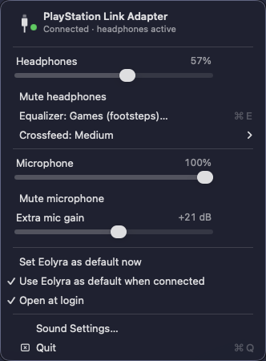
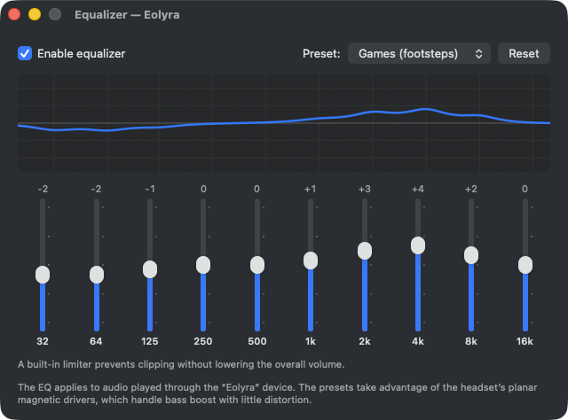

<p align="center">
  
</p>

<h1 align="center">Eolyra</h1>

<p align="center"><em>Volume control, EQ and crossfeed for PlayStation Link headsets on macOS.</em></p>

<p align="center"><strong>English</strong> · <a href="README.pt-BR.md">Português (Brasil)</a></p>

<p align="center">
  
  &nbsp;
  
</p>

Eolyra adds headphone and microphone volume control, an equalizer and crossfeed on macOS for headsets that use the **PlayStation Link USB adapter**, such as the Pulse Elite.

## The problem

When you plug the PlayStation Link adapter into a Mac, sound works, but:

| | Without Eolyra | With Eolyra |
|---|---|---|
| Volume keys / Sound slider | don't work (grayed out) | ✅ work |
| Microphone volume | doesn't exist | ✅ slider + mute + up to +40 dB extra gain |
| Equalizer | doesn't exist | ✅ 10-band EQ with presets |
| Fatigue from long sessions ("inside your head" sound) | — | ✅ crossfeed, 3 strengths |
| Plugging / unplugging the adapter | manual device switching | ✅ automatic |

The cause is that the adapter doesn't expose any volume or mute control through the standard USB Audio interface. Windows works around this by applying software volume to any device; macOS doesn't. Sony doesn't offer a Mac app either.

## Features

- **Headphone volume** from the keyboard keys, the menu bar and Sound Settings, like any other headphones.
- **Microphone** volume, mute and **extra gain** up to +40 dB, with a soft limiter to prevent harsh clipping.
- **10-band graphic equalizer** (32 Hz – 16 kHz) with a live response curve and a built-in limiter that prevents clipping without lowering the overall volume. Presets: Flat, Bass, Games (footsteps), Music, Movies and Voice / calls. They were designed for the Pulse Elite's planar magnetic drivers, which handle bass boost with little distortion.
- **Eolyra Space**, our own crossfeed, in three strengths. Like listening to speakers, each ear also hears the opposite side slightly later (interaural delay) and with fewer highs (head shadow). It only processes the difference between channels, so centered content such as vocals and dialogue passes through untouched, and long headphone sessions become less tiring.
- **Automatic:** Eolyra becomes the default output and input when the adapter is plugged in, and hands audio back to the previous device when it's unplugged.
- **Lightweight:** the audio bridge only runs while some app is using the device, so the microphone indicator isn't lit for nothing.
- Volume, mute, gain, EQ and crossfeed are remembered after a restart.
- Available in **English** and **Portuguese (Brazil)**, following the system language.

## Compatibility

**Headsets**

| Headset | Status |
|---|---|
| PlayStation Pulse Elite (via the PlayStation Link adapter) | ✅ tested |
| PlayStation Pulse Explore (same adapter) | should work, not tested |
| Pulse 3D and other headsets with their own adapter | not supported |

The app detects the adapter by its name, "PlayStation Link Adapter" (USB `054C:0ECC`).

**Macs**

- macOS 13 Ventura or later.
- Universal binaries: **Apple Silicon (arm64)** and **Intel (x86_64)**. Tested on Intel with macOS 26; Apple Silicon hasn't been tested on real hardware yet.

## How it works

Eolyra installs its own audio driver (an AudioServerPlugIn written from scratch in C) with two virtual devices that have **native volume control**:

| Device          | Type            | Use it as                        |
|-----------------|-----------------|----------------------------------|
| `Eolyra`     | output (stereo) | system output (headphones)       |
| `Eolyra Mic` | input (mono)    | microphone in Zoom, Discord etc. |

A menu bar app bridges these devices to the real adapter. It uses a private *aggregate device* with the adapter as the main clock and *drift compensation* on the virtual side. The headphone path runs through the EQ, the crossfeed and a soft limiter; the microphone path applies the extra gain.

Each device is paired with a hidden counterpart that shares its clock and ring buffer; the bridge reads from and writes to those hidden devices. `Driver/Tests/Loopback` checks both pairs end to end (signal, volume curve and mute).

Eolyra **doesn't change anything on the adapter or the headset**. Everything happens on the Mac, so the headset keeps working as before on the PS5.

## Installation

Requires the Xcode Command Line Tools (`xcode-select --install`). The full Xcode isn't needed.

```sh
git clone https://github.com/dinoblack/Eolyra.git
cd Eolyra
./scripts/build.sh
./scripts/install.sh   # asks for an admin password and restarts Mac audio for 1-2 s
```

The Eolyra icon shows up in the menu bar. The first time an app uses `Eolyra Mic`, macOS asks for microphone permission for Eolyra.

To remove everything: `./scripts/uninstall.sh`.

## Behavior

- **Login / restart:** the app opens automatically at login (you can turn this off in the menu).
- **Unplugging the USB adapter** (for example, to use it on the PS5): the bridge stops and Mac audio goes back to the device you used before.
- **Plugging it back in:** Eolyra becomes the default again and your settings are kept.
- **Quitting the app:** output and input go back to the original adapter. Sound keeps working, just without volume control or EQ.

## FAQ

**Do the headset's volume and mute buttons control the app?**
No. The adapter doesn't send those button events to the Mac (it doesn't present itself as a keyboard or media controller), so they keep acting only inside the headset. Use the keyboard volume keys.

**Why do I need a password to install?**
The audio drivers live in `/Library/Audio/Plug-Ins/HAL`, a system folder.

## Roadmap

- **Sync the headset buttons with the Mac** (volume, mic mute, PS Link button). The adapter only sends these events after a proprietary activation command, which Sony's PS Link PC Driver uses on Windows. The plan is to capture that USB traffic on Windows (USBPcap + Wireshark) and implement the protocol. Contributions with captures are welcome.
- Show the headset battery level, if the protocol allows it.

## Project layout

```
App/Sources/       menu bar app (Swift, AppKit): bridge, EQ, crossfeed, UI
App/Resources/     icons, Info.plist and translations (en, pt-BR)
Driver/            the Eolyra audio driver (C) and its loopback test
design/            logo and icons as SVG (+ export.sh to regenerate the assets)
docs/screenshots/  README images
scripts/           build, install and uninstall
```

## License

MIT — see [LICENSE](LICENSE).

PlayStation, PlayStation Link, Pulse Elite, Pulse Explore and Pulse 3D are trademarks of Sony Interactive Entertainment. This project is not affiliated with Sony.
