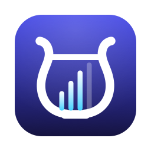
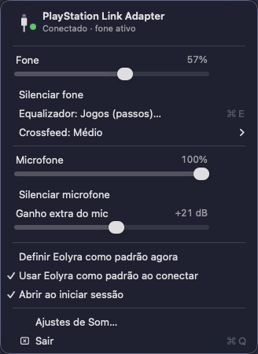
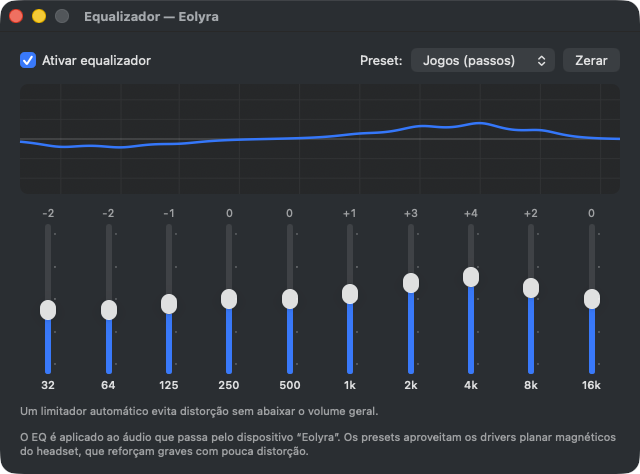

<p align="center">
  
</p>

<h1 align="center">Eolyra</h1>

<p align="center"><em>Controle de volume, EQ e crossfeed para headsets PlayStation Link no macOS.</em></p>

<p align="center"><a href="README.md">English</a> · <strong>Português (Brasil)</strong></p>

<p align="center">
  
  &nbsp;
  
</p>

O Eolyra traz controle de volume do fone e do microfone, equalizador e crossfeed no macOS para headsets que usam o **adaptador USB PlayStation Link**, como o Pulse Elite.

## O problema

Ao plugar o adaptador PlayStation Link no Mac, o som funciona, mas:

| | Sem o Eolyra | Com o Eolyra |
|---|---|---|
| Teclas de volume / slider de Som | não funcionam (cinza) | ✅ funcionam |
| Volume do microfone | não existe | ✅ slider + mute + ganho extra até +40 dB |
| Equalizador | não existe | ✅ EQ de 10 bandas com presets |
| Cansaço de ouvir por horas (som "dentro da cabeça") | — | ✅ crossfeed em 3 intensidades |
| Plugar / desplugar o adaptador | troca de dispositivo manual | ✅ automático |

A causa é que o adaptador não informa ao sistema nenhum controle de volume ou mute pelo padrão USB Audio. O Windows contorna isso aplicando volume por software em qualquer dispositivo; o macOS, não. A Sony também não oferece app para Mac.

## Recursos

- **Volume do fone** pelas teclas do teclado, pela barra de menus e pelos Ajustes de Som, como em qualquer fone.
- **Microfone** com volume, mute e **ganho extra** de até +40 dB, com limitador suave para não estourar.
- **Equalizador gráfico** de 10 bandas (32 Hz a 16 kHz) com curva de resposta e um limitador automático que evita distorção sem abaixar o volume geral. Presets: Plano, Graves, Jogos (passos), Música, Filmes e Voz/chamadas. Os presets foram pensados para os drivers planar magnéticos do Pulse Elite, que aceitam reforço de graves com pouca distorção.
- **Eolyra Space**, nosso próprio crossfeed, em três intensidades. Como acontece com caixas de som, cada ouvido também ouve o lado oposto um pouco depois (atraso interaural) e com menos agudos (sombra da cabeça). Ele processa só a diferença entre os canais, então o que está no centro, como voz e diálogo, passa intacto, e o fone fica menos cansativo em sessões longas.
- **Automático:** o Eolyra vira a saída e a entrada padrão ao plugar o adaptador e devolve o áudio ao dispositivo anterior ao desplugar.
- **Leve:** a ponte de áudio só roda enquanto algum app usa o dispositivo, então o indicador de microfone não fica aceso à toa.
- Volumes, mute, ganho, EQ e crossfeed são lembrados depois de reiniciar o Mac.
- Disponível em **inglês** e **português (Brasil)**, seguindo o idioma do sistema.

## Compatibilidade

**Headsets**

| Headset | Status |
|---|---|
| PlayStation Pulse Elite (via adaptador PlayStation Link) | ✅ testado |
| PlayStation Pulse Explore (mesmo adaptador) | deve funcionar, não testado |
| Pulse 3D e outros headsets com adaptador próprio | não suportado |

O app reconhece o adaptador pelo nome "PlayStation Link Adapter" (USB `054C:0ECC`).

**Macs**

- macOS 13 Ventura ou mais recente.
- Binários universais: **Apple Silicon (arm64)** e **Intel (x86_64)**. Testado em Intel com macOS 26; Apple Silicon ainda não foi testado na prática.

## Como funciona

O Eolyra instala um driver de áudio próprio (um AudioServerPlugIn escrito do zero em C) com dois dispositivos virtuais que têm **controle de volume nativo**:

| Dispositivo     | Tipo            | Use como                        |
|-----------------|-----------------|---------------------------------|
| `Eolyra`     | saída (estéreo) | saída do sistema (fone)         |
| `Eolyra Mic` | entrada (mono)  | microfone no Zoom, Discord etc. |

Um app de barra de menus faz a ponte entre esses dispositivos e o adaptador real. Para isso ele usa um *aggregate device* privado, com o adaptador como clock principal e *drift compensation* no lado virtual. No caminho do fone ficam o EQ, o crossfeed e um limitador suave; no do microfone, o ganho extra.

Cada dispositivo tem um par oculto que compartilha o mesmo relógio e buffer em anel; a ponte lê e escreve nesses dispositivos ocultos. O teste em `Driver/Tests/Loopback` verifica os dois pares de ponta a ponta (sinal, curva de volume e mute).

O Eolyra **não altera nada no adaptador nem no headset**. Tudo acontece no Mac, então no PS5 o headset continua funcionando como antes.

## Instalação

Requer as Xcode Command Line Tools (`xcode-select --install`). O Xcode completo não é necessário.

```sh
git clone https://github.com/dinoblack/Eolyra.git
cd Eolyra
./scripts/build.sh
./scripts/install.sh   # pede senha de admin e reinicia o áudio do Mac por 1-2 s
```

O ícone do Eolyra aparece na barra de menus. Na primeira vez que um app usar o `Eolyra Mic`, o macOS pede permissão de microfone para o Eolyra.

Para remover tudo: `./scripts/uninstall.sh`.

## Comportamento

- **Login / reboot:** o app abre sozinho no login (dá para desligar no menu).
- **Tirar o adaptador USB** (por exemplo, para usar no PS5): a ponte para e o som do Mac volta para o dispositivo usado antes.
- **Plugar de volta:** o Eolyra vira o padrão de novo e as configurações são mantidas.
- **Fechar o app:** a saída e a entrada voltam para o adaptador original. Continua com som, só sem controle de volume nem EQ.

## Perguntas frequentes

**Os botões de volume e mute do headset controlam o app?**
Não. O adaptador não envia os eventos desses botões ao Mac (ele não se apresenta como teclado ou controle de mídia), então eles continuam agindo só no próprio headset. Use as teclas de volume do teclado.

**Por que preciso de senha para instalar?**
Os drivers de áudio ficam em `/Library/Audio/Plug-Ins/HAL`, uma pasta do sistema.

## Próximas versões

- **Sincronizar os botões do headset com o Mac** (volume, mute do mic, botão PS Link). O adaptador só envia esses eventos depois de um comando de ativação proprietário, que o PS Link PC Driver da Sony usa no Windows. O plano é capturar esse tráfego USB no Windows (USBPcap + Wireshark) e implementar o protocolo. Contribuições com capturas são bem-vindas.
- Mostrar o nível de bateria do headset, se o protocolo permitir.

## Estrutura

```
App/Sources/       app de barra de menus (Swift, AppKit): ponte, EQ, crossfeed, interface
App/Resources/     ícones, Info.plist e traduções (en, pt-BR)
Driver/            driver de áudio do Eolyra (C) e o teste de loopback
design/            logo e ícones em SVG (+ export.sh para regenerar os assets)
docs/screenshots/  imagens do README
scripts/           build, instalação e desinstalação
```

## Licença

MIT — veja [LICENSE](LICENSE).

PlayStation, PlayStation Link, Pulse Elite, Pulse Explore e Pulse 3D são marcas da Sony Interactive Entertainment. Este projeto não é afiliado à Sony.
